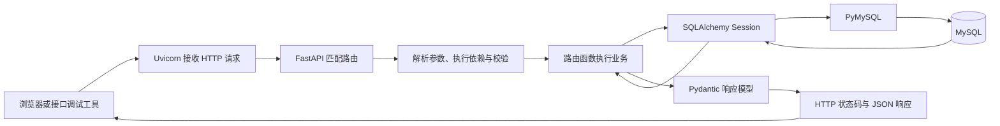
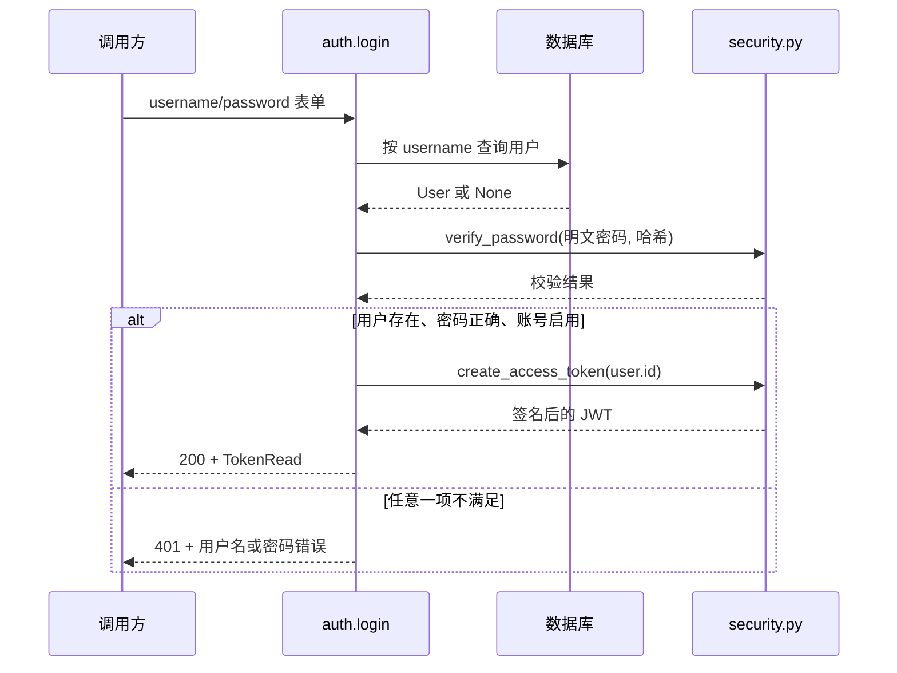
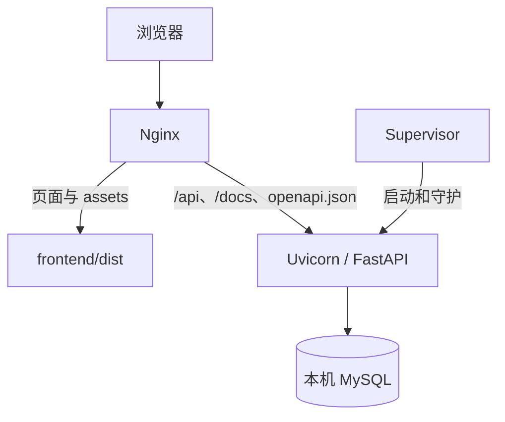

# Goodstock Python 后端：从 0 到 1 分步拆解

本文对应当前仓库的真实代码，整理日期为 **2026-11-19**。目标是带你从“能启动项目”，走到“能解释每个模块、独立修改一个接口，并用测试验证”。

这是一套 **FastAPI + SQLAlchemy 2 + MySQL 的商品管理后端**。它不是完整电商系统：业务集中在管理员登录和商品管理，正适合第一次系统学习后端。

建议把本文当作实验手册：每完成一步，打开对应源文件、运行一个例子，再回答该步骤的自检问题。先完成第一轮理解，再做最后的独立重建练习。

> 所有终端命令都标明执行目录。下文展示的账号、密码来自开发模板；你本机已有账号不一定仍使用这些默认值。本文没有读取或展示本机 `.env`、`.env.production` 的实际内容，也没有操作现有 MySQL 数据。

## 阅读导航

| 步骤 | 你要解决的问题 | 重点文件 |
| --- | --- | --- |
| [0](#step-0) | 这个后端到底在做什么？ | 项目全貌 |
| [1](#step-1) | 浏览器如何与后端说话？ | HTTP 基础 |
| [2](#step-2) | 为什么需要这么多库和文件？ | 依赖与目录 |
| [3](#step-3) | 看代码前需要哪些 Python 语法？ | Python 语法对照 |
| [4](#step-4) | 怎样在本地跑起来？ | 环境、配置、初始化 |
| [5](#step-5) | 服务从哪里启动？ | `main.py` |
| [6](#step-6) | 配置如何进入代码？ | `config.py`、`setup_env.py` |
| [7](#step-7) | Python 怎样访问数据库？ | `database.py` |
| [8](#step-8) | 数据怎样变成表？ | `models.py`、`init_db.py` |
| [9](#step-9) | 请求与响应怎样校验？ | `schemas.py` |
| [10](#step-10) | 用户怎样登录？ | `security.py`、`routers/auth.py` |
| [11](#step-11) | 后端怎样知道你是谁？ | `dependencies.py` |
| [12](#step-12) | 搜索、筛选、分页怎么写？ | `list_products` |
| [13](#step-13) | 怎样安全地新增商品？ | `create_product`、`save_product` |
| [14](#step-14) | 修改和删除与新增有何区别？ | `update_product`、`delete_product` |
| [15](#step-15) | 统计与异常如何处理？ | `product_stats`、异常处理 |
| [16](#step-16) | 怎样证明功能确实正确？ | `tests/`、`smoke_api.py` |
| [17](#step-17) | 前端和服务器如何连接后端？ | `api.js`、Vite、Nginx |
| [18](#step-18) | 怎样亲手把项目重新搭一遍？ | 重建顺序与练习 |
| [19](#step-19) | 学习时遇到问题怎样排查？ | 排障表与知识清单 |
| [20](#step-20) | 本文验证过什么，项目还有哪些边界？ | 验证记录与进阶方向 |

<a id="step-0"></a>
## 第 0 步：先看懂业务，不急着读代码

### 0.1 把自己当成系统使用者

你打开商品管理页面，需要完成这些动作：

1. 输入用户名和密码登录。
2. 查看商品列表。
3. 搜索“耳机”，或者只看某个分类、某种状态。
4. 新增一个商品。
5. 修改商品价格、库存、上下架状态。
6. 删除商品。
7. 查看商品数量、在售数量、库存预警和库存总值。

后端负责判断这些请求是否允许、参数是否正确、数据怎样保存，以及返回什么结果。

### 0.2 项目里有两类核心数据

| 数据 | 数据库表 | Python 类 | 用途 |
| --- | --- | --- | --- |
| 用户 | `users` | `User` | 校验登录身份、判断是否启用 |
| 商品 | `products` | `Product` | 保存名称、SKU、分类、价格、库存等 |

**当前代码没有用户与商品的归属关系。** `products` 没有 `user_id`；通过认证的有效用户能够操作全部商品。不要因为存在登录，就推断已经有“每个用户只看自己的商品”或角色权限。

### 0.3 一次请求经过哪些地方



这张图是理解整个项目的主线。后面的每个文件，都可以放回图中找自己的位置。

注意：这是理解分工的示意图。FastAPI 会在处理请求时解析参数和依赖；不要把它理解成所有接口都严格执行“先完成全部参数校验，再进行鉴权”的固定时间顺序。

### 0.4 项目采用什么分层

```text
main.py                组装应用
routers/               定义接口并直接处理简单业务
dependencies.py        提供数据库会话、当前用户等依赖
schemas.py             描述接口输入和输出
models.py              描述数据库表
database.py            建立数据库引擎与会话工厂
config.py              提供配置
security.py            提供密码和 Token 工具
```

当前项目**没有独立的 `services/`、`repositories/` 层**。商品路由直接使用 ORM，这是小项目的实际结构。先理解现有分工，等业务复杂后再学习何时拆服务层。

**本步自检：** 不打开代码，你能否说清“登录之后为什么还要在商品接口里校验身份”？

<a id="step-1"></a>
## 第 1 步：补齐最少的 HTTP 知识

### 1.1 请求由哪几部分组成

以创建商品为例：

```http
POST /api/products HTTP/1.1
Host: 127.0.0.1:8001
Authorization: Bearer YOUR_TOKEN
Content-Type: application/json

{
  "name": "学习用耳机",
  "sku": "LEARN-001",
  "category": "数码配件",
  "price": "99.90",
  "stock": 5,
  "status": "active",
  "description": "学习请求使用"
}
```

| 组成 | 本例 | 后端如何使用 |
| --- | --- | --- |
| 方法 | `POST` | 表示创建操作 |
| 路径 | `/api/products` | 匹配商品创建路由 |
| 请求头 | `Authorization` | 提取登录 Token |
| 内容类型 | `application/json` | 告诉框架怎样解析请求体 |
| 请求体 | JSON 对象 | 解析为 `ProductInput` |

不要混淆三种参数：

```text
GET /api/products/12
                  └─ 路径参数 product_id

GET /api/products?page=2&page_size=8&q=耳机
                  └─ 查询参数

POST /api/products
     请求体中放商品 JSON
```

### 1.2 JSON 与 Python 字典并不完全相同

```python
# Python
{"stock": 5, "enabled": True, "description": None}
```

```json
{"stock": 5, "enabled": true, "description": null}
```

JSON 是跨语言传输格式；Python 字典是程序里的对象。FastAPI 和 Pydantic 帮你在两者之间转换。不要直接把 Python 的 `True`、`None` 写进 JSON。

### 1.3 当前项目的接口全表

| 方法 | 路径 | 认证 | 输入 | 成功状态 | 输出 |
| --- | --- | --- | --- | --- | --- |
| GET | `/api/health` | 无 | 无 | 200 | `{"status":"ok"}` |
| POST | `/api/auth/login` | 无 | 用户名、密码表单 | 200 | `TokenRead` |
| GET | `/api/auth/me` | 需要 | Bearer Token | 200 | `UserRead` |
| GET | `/api/products` | 需要 | 搜索、筛选、分页参数 | 200 | `ProductPage` |
| GET | `/api/products/stats` | 需要 | 无筛选参数 | 200 | `ProductStats` |
| GET | `/api/products/{product_id}` | 需要 | 商品 ID | 200 | `ProductRead` |
| POST | `/api/products` | 需要 | 商品 JSON | 201 | `ProductRead` |
| PUT | `/api/products/{product_id}` | 需要 | ID + 商品 JSON | 200 | `ProductRead` |
| DELETE | `/api/products/{product_id}` | 需要 | 商品 ID | 204 | 无响应体 |

### 1.4 先记住这些状态码

| 状态码 | 当前项目中的含义 | 典型触发方式 |
| --- | --- | --- |
| 200 | 查询、登录或修改成功 | 正常获取列表 |
| 201 | 创建成功 | 新增商品 |
| 204 | 删除成功，无响应体 | 删除已有商品 |
| 401 | 没有有效登录身份 | 密码错误、Token 缺失或过期 |
| 404 | 目标资源不存在 | 查询一个不存在的商品 |
| 409 | 数据冲突 | 重复 SKU |
| 422 | 输入不符合接口约束 | 负库存、非法分类、价格精度错误 |
| 503 | 捕获到未被局部处理的数据库异常 | MySQL 连接失败 |

本项目未实现角色权限，因此没有业务上的“你已登录，但没有某项角色权限”的 `403` 分支。

**本步练习：** 在接口文档里区分 `product_id`、`page`、`body` 分别属于哪种参数。

<a id="step-2"></a>
## 第 2 步：理解技术栈与每个目录的职责

### 2.1 依赖库各做什么

打开 [`backend/requirements.txt`](../backend/requirements.txt)。

| 依赖 | 作用 | 如果没有它 |
| --- | --- | --- |
| `fastapi` | 路由、依赖注入、校验集成、接口文档 | 需要自己组织 Web 接口 |
| `uvicorn[standard]` | ASGI 服务器，监听端口并运行 FastAPI 应用 | 应用对象没有 HTTP 服务入口 |
| `SQLAlchemy` | ORM、SQL 构造、会话和事务 | 需要手动组织更多数据库操作 |
| `PyMySQL[rsa]` | 与 MySQL 通信的驱动，并支持相关认证依赖 | SQLAlchemy 的 MySQL 连接缺少实际驱动 |
| `pydantic-settings` | 从环境变量、配置文件构造配置对象 | 需要自行读取与校验配置 |
| `PyJWT` | 签发和验证 JWT | 需要其他 Token 实现 |
| `pwdlib[argon2]` | 生成、校验密码哈希 | 缺少当前密码存储方案 |
| `python-multipart` | 支持 FastAPI 的表单解析 | 当前登录表单无法正常使用 |

Pydantic 在源码中被直接使用；它也会作为 FastAPI / pydantic-settings 的依赖安装。

开发依赖见 [`backend/requirements-dev.txt`](../backend/requirements-dev.txt)：

- `pytest`：执行测试。
- `httpx`：测试客户端相关依赖，也用于真实 HTTP 验证脚本。
- `ruff`：检查代码和格式。
- `-r requirements.txt`：安装开发依赖时同时包含运行依赖。

`>=0.115,<1.0` 这样的写法表示版本区间，并没有锁定到某个补丁版本。因此不同安装日期可能得到不同版本；遇到第三方警告时，应先确认实际安装版本。

### 2.2 后端完整目录

```text
backend/
├── .env.example               开发配置模板，可提交到 Git
├── .env.production.example    生产配置模板
├── .env                       本机开发配置，被 Git 忽略
├── .env.production            本机/服务器生产配置，被 Git 忽略
├── .venv/                     本地 Python 虚拟环境，被 Git 忽略
├── requirements.txt           运行依赖
├── requirements-dev.txt       开发与测试依赖
├── pyproject.toml             pytest、Ruff 的配置
├── app/
│   ├── __init__.py            Python 包标记与包说明
│   ├── main.py                组装 FastAPI 应用
│   ├── config.py              读取并校验配置
│   ├── database.py            Engine、Session、Base、get_db
│   ├── models.py              User、Product ORM 模型
│   ├── schemas.py             请求与响应的 Pydantic 模型
│   ├── security.py            密码哈希、JWT 签发
│   ├── dependencies.py        DbSession、当前用户校验
│   ├── init_db.py             创建库、表、管理员、演示商品
│   └── routers/
│       ├── __init__.py        路由包标记
│       ├── auth.py            登录与当前用户接口
│       └── products.py        商品接口与统计
├── scripts/
│   ├── setup_env.py           生成开发/生产配置与随机密钥
│   ├── smoke_api.py           真实 HTTP + 数据库流程验证
│   └── start_prod.sh          Linux 生产启动脚本
└── tests/
    ├── conftest.py            测试数据库、用户、Token、样例数据
    └── test_api.py            接口行为测试
```

### 2.3 两个经常混淆的文件

| 对比 | `models.py` | `schemas.py` |
| --- | --- | --- |
| 对谁负责 | 数据库存储 | HTTP 接口的数据契约 |
| 核心基类 | SQLAlchemy 的 `Base` | Pydantic 的 `BaseModel` |
| 例子 | `Product` 对应 `products` 表 | `ProductInput` 对应请求 JSON |
| 能否规定数据库索引 | 能 | 不能 |
| 能否拒绝请求里的额外字段 | 不承担这个职责 | 能 |
| 是否应该直接暴露所有字段 | 不应该 | 通过响应模型挑选字段 |

例如 `User.password_hash` 必须保存进数据库，但 `UserRead` 不包含它，因此用户查询接口不会把密码哈希返回给浏览器。

**本步自检：** 如果要增加“商品品牌”字段，你为什么往往需要同时修改 `models.py` 和 `schemas.py`？

<a id="step-3"></a>
## 第 3 步：先掌握项目实际用到的 Python 语法

不需要先学完全部 Python。先能读懂下面这些语法，再在项目中反复练习。

### 3.1 模块、包和导入

```python
from app.models import Product
```

含义是：从 `app` 包中的 `models.py` 导入 `Product`。

通常在 `backend` 目录执行：

```bash
python -m app.init_db
```

`-m` 让 Python 把 `app.init_db` 当模块运行，便于按包结构解析导入。直接执行 `python app/init_db.py` 可能因模块搜索路径不同而找不到 `app`。

### 3.2 类型标注和默认值

```python
def create_access_token(user_id: int) -> str:
    ...
```

- `user_id: int`：参数预期是整数。
- `-> str`：函数预期返回字符串。
- 普通 Python 类型标注本身不会自动拦截错误；FastAPI、Pydantic 会读取这些标注并实现解析和校验。

```python
category: Category | None = None
```

表示分类可以是允许的分类值，也可以不存在；省略时默认 `None`。

### 3.3 类和继承

```python
class ProductRead(ProductInput):
    id: int
```

`ProductRead` 继承 `ProductInput` 的字段，再增加 `id` 等输出字段，避免重复定义相同字段。

### 3.4 装饰器

```python
@router.get("/stats")
def product_stats(db: DbSession):
    ...
```

可以先理解为：把这个函数登记为处理 `GET /stats` 的接口。装饰器在模块被导入、函数被定义时执行，函数体则在匹配请求到来时执行。

### 3.5 `Annotated`：类型加附加说明

```python
DbSession = Annotated[Session, Depends(get_db)]
```

对类型检查工具说：“这是 `Session`”；对 FastAPI 说：“请通过 `get_db` 提供它”。

### 3.6 字典展开 `**`

```python
data = {"name": "耳机", "stock": 5}
Product(**data)
```

等价于：

```python
Product(name="耳机", stock=5)
```

项目中 `Product(**body.model_dump())` 就是在把输入模型转换成字典，再作为 ORM 对象的构造参数。

### 3.7 动态属性赋值

```python
setattr(product, "stock", 18)
```

等价于 `product.stock = 18`。当字段名称放在变量里时，`setattr` 可以在循环中通用地赋值。

### 3.8 `with`、`yield` 和资源清理

```python
def get_db():
    with SessionLocal() as session:
        yield session
```

- `with`：进入并退出资源上下文。
- `yield`：先把会话交给请求处理过程使用，之后还能继续执行清理流程。
- FastAPI 负责管理这个依赖的进入与退出；普通 Python 手动调用 `get_db()` 只会得到生成器。

### 3.9 赋值表达式 `:=`

```python
if keyword := q.strip():
    ...
```

等价的理解方式：

```python
keyword = q.strip()
if keyword:
    ...
```

### 3.10 `raise`、`try/except`

```python
try:
    db.commit()
except IntegrityError:
    db.rollback()
    raise HTTPException(status_code=409, detail="商品编码 SKU 已存在，请使用其他编码")
```

数据库异常发生时，先回滚事务，再向接口调用者返回业务可理解的错误。

### 3.11 `def` 与 `async def`

当前多数接口使用普通 `def`，数据库也是同步 SQLAlchemy + PyMySQL。FastAPI 通常会把同步接口函数放到线程池中运行。

**不要为了“看起来高级”直接把所有函数改成 `async def`。** 异步函数里直接执行阻塞数据库调用，仍可能阻塞事件循环；真正采用异步数据库通常还需要异步驱动、`AsyncSession`、`await` 等配套调整。

`main.py` 的生命周期和异常处理函数使用 `async def`，并不意味着整个项目已经采用异步数据库。

**本步练习：** 自己写一个普通 Python 字典，用 `**` 创建对象，再用 `setattr` 改一个属性，确认语法含义。

<a id="step-4"></a>
## 第 4 步：先跑起来，并分清“初始化”和“日常启动”

### 4.1 需要哪些环境

- Python 3.11+。代码使用 `datetime.UTC` 等特性。
- MySQL 8+，本机服务已经启动。
- 一个终端和代码编辑器。
- 学后端第一轮不需要先启动 Vue；可以直接用 Swagger 和 curl。

### 4.2 全新环境的第一次操作

在项目根目录执行：

```bash
cd /Users/along/Desktop/Agent-web/Goodstock/backend
python3 --version
python3 -m venv .venv
source .venv/bin/activate
python -m pip install -r requirements-dev.txt
python scripts/setup_env.py
```

逐条理解：

1. 进入后端目录，让 `app` 成为可以导入的包。
2. 确认 Python 版本。
3. 创建项目独立依赖环境。
4. 激活环境，让当前终端优先使用环境中的 Python。
5. 安装运行、测试和检查依赖。
6. 从模板生成 `.env` 和随机 JWT 密钥。

然后打开 `backend/.env`，确认数据库配置符合自己的本机环境。开发模板是 `127.0.0.1:3306`、`root/root`、`fastapi_shop`；不要假设自己安装的 MySQL 一定也是这个密码。

确认配置后，在 `backend` 目录执行：

```bash
python -m app.init_db
python -m uvicorn app.main:app --reload --host 127.0.0.1 --port 8001
```

`init_db` 是写数据库的初始化操作；它会创建专用库、表、管理员和演示数据。学习实验应使用本地学习数据库。本文整理时没有代你执行这一步。

### 4.3 如果项目已经有 `.venv` 和 `.env`

不要把“首次搭建”命令每天全部执行一遍。已有依赖和已初始化数据库时：

```bash
cd /Users/along/Desktop/Agent-web/Goodstock/backend
source .venv/bin/activate
python -m uvicorn app.main:app --reload --host 127.0.0.1 --port 8001
```

也可以不激活环境，显式使用：

```bash
./.venv/bin/python -m uvicorn app.main:app --reload --host 127.0.0.1 --port 8001
```

两种方式选择一种即可。

### 4.4 第一次启动后按这个顺序检查

1. 打开 [健康检查](http://127.0.0.1:8001/api/health)，应得到 `{"status":"ok"}`。
2. 打开 [Swagger](http://127.0.0.1:8001/docs)。
3. 展开 `POST /api/auth/login`，点击 `Try it out`，输入本机数据库中的用户名、密码。
4. 执行登录，观察返回的 `access_token`、`token_type`、`expires_in`、`user`。
5. 使用页面上方 `Authorize`，在用户名、密码框中登录授权。
6. 调用 `GET /api/auth/me`。
7. 调用 `GET /api/products`。

开发模板首次创建的账号是 `admin / Admin@123456`；已有数据库如果修改过密码，应使用修改后的值。

**重要区别：健康检查只证明应用能处理这个请求，不证明 MySQL 可连接。** 登录或商品查询成功，才实际验证了相关数据库访问。

### 4.5 不启动 MySQL，也能先学习自动化测试

在 `backend` 目录执行：

```bash
./.venv/bin/python -m pytest -q
```

测试通过依赖覆盖使用独立 SQLite 内存数据库，不运行 `init_db`，也不修改现有 MySQL。第 16 步会详细解释这个设计。

**本步交付物：** 一张成功登录的接口响应截图或你自己的笔记，记录端口、账号来源和启动命令；不要在公开笔记中保存真实 Token 或密钥。

<a id="step-5"></a>
## 第 5 步：拆开启动入口 `main.py`

源码：[`backend/app/main.py`](../backend/app/main.py)。先读这个文件，建立应用全貌。

### 5.1 启动命令到底启动了什么

```bash
python -m uvicorn app.main:app --reload --host 127.0.0.1 --port 8001
```

| 部分 | 意义 |
| --- | --- |
| `python -m uvicorn` | 使用当前 Python 环境中的 Uvicorn |
| `app.main` | 导入 `app/main.py` 模块 |
| `:app` | 取模块中名为 `app` 的 ASGI 应用对象 |
| `--reload` | 开发时检测代码变动并重新加载 |
| `--host 127.0.0.1` | 只监听本机地址 |
| `--port 8001` | 接收 HTTP 请求的端口 |

Uvicorn 是运行应用的服务器；`FastAPI(...)` 创建的是应用对象。两者分工不同。

### 5.2 导入期间发生的事

可以按下面的简化过程理解：

```text
导入 app.main
  ├─ 导入 config，准备配置读取逻辑
  ├─ 导入 database，创建 Engine 和 Session 工厂
  ├─ 导入 auth、products，定义路由函数和模型
  ├─ 获取配置
  ├─ 创建 FastAPI 对象
  ├─ 注册 CORS 中间件与数据库异常处理器
  ├─ 注册健康检查
  └─ include_router，把两个路由组装进应用
```

数据库引擎通常在首次真正需要数据库连接时才建立物理连接。因此，“创建 Engine 成功”和“数据库连通”不是同一件事。

### 5.3 创建应用

```python
app = FastAPI(
    title=settings.app_name,
    description="Vue 3 + FastAPI + MySQL 商品管理学习案例。商品接口均需 Bearer Token。",
    version="1.0.0",
    lifespan=lifespan,
)
```

这些参数用于应用元信息、接口文档和生命周期管理。FastAPI 还会按默认配置提供 `/docs`、`/redoc`、`/openapi.json`。

### 5.4 生命周期函数

```python
@asynccontextmanager
async def lifespan(app: FastAPI):
    yield
    engine.dispose()
```

- `yield` 之前：应用启动阶段。当前没有额外初始化逻辑。
- `yield` 期间：应用正常处理请求。
- `yield` 之后：应用关闭阶段，释放引擎连接池资源。

**应用启动不会自动创建数据库或表。** 创建库表是独立的 `python -m app.init_db` 命令。

### 5.5 CORS 在做什么

```python
app.add_middleware(
    CORSMiddleware,
    allow_origins=settings.cors_origins,
    allow_credentials=False,
    allow_methods=["GET", "POST", "PUT", "DELETE"],
    allow_headers=["Authorization", "Content-Type"],
)
```

同源要求协议、主机、端口相同。`http://127.0.0.1:5174` 和 `http://127.0.0.1:8001` 端口不同，浏览器视为跨源。

这段代码告诉浏览器哪些源、方法、请求头可以用于跨源请求。预检 `OPTIONS` 由中间件处理，不需要你给每个接口手写一个 `OPTIONS` 函数。

当前开发前端通常通过 Vite 的 `/api` 代理请求后端，所以浏览器看到的请求仍是前端同源地址；如果直接请求 8001，则要符合 CORS 配置。

**CORS 是浏览器的跨源机制，不是登录认证。** curl 不受浏览器 CORS 限制，但调用商品接口仍需要有效 Token。

### 5.6 注册路由

```python
app.include_router(auth.router)
app.include_router(products.router)
```

`routers/auth.py` 和 `routers/products.py` 分别维护一组接口，`main.py` 把它们组合起来。文件放进 `routers/` 目录本身不会自动注册，仍然需要导入和 `include_router`。

**本步练习：** 在自己的学习分支里添加一个 `GET /api/ping` 返回 `{"message":"pong"}`，通过 `/docs` 调用。理解后可撤销练习改动。

<a id="step-6"></a>
## 第 6 步：拆配置系统

源码：[`config.py`](../backend/app/config.py)、[`setup_env.py`](../backend/scripts/setup_env.py)。

### 6.1 为什么不把配置直接写死

同一份代码可能运行在本地和服务器，但数据库账号、JWT 密钥、允许访问的前端地址不同。

代码负责“怎么工作”，配置提供“在哪工作、用哪些参数”。因此当前项目把配置集中到 `Settings`。

### 6.2 `Settings` 是一个带校验的配置类

```python
class Settings(BaseSettings):
    db_host: str = "127.0.0.1"
    db_port: int = 3306
    jwt_secret_key: str = Field(min_length=32)
    access_token_expire_minutes: int = Field(default=60, ge=1, le=1440)
```

含义：

- 配置可以来自环境变量和 `.env`。
- `db_port` 会按整数解析。
- JWT 密钥必须提供，至少 32 个字符。
- Token 有效期默认 60 分钟，允许范围为 1～1440 分钟。
- 配置不合法时通常在应用导入/启动阶段报错，而不是等到某个接口运行后才发现。

### 6.3 配置文件位置为什么不依赖当前终端目录

```python
env_file=Path(__file__).resolve().parents[1] / ".env"
```

从 `backend/app/config.py` 所在位置向上定位到 `backend`，再拼接 `.env`。

这样读取配置的位置稳定；不过 Python 的模块导入仍依赖合适的运行目录，所以教程统一让你在 `backend` 执行命令。

### 6.4 开发和生产怎样切换

```python
@lru_cache
def get_settings() -> Settings:
    if getenv("APP_ENV") == "production":
        return Settings(_env_file=Path(__file__).resolve().parents[1] / ".env.production")
    return Settings()
```

只有进程环境变量 `APP_ENV` 恰好等于 `production`，才选择 `.env.production`。

```bash
# backend 目录；macOS / Linux 的单次进程环境变量写法
APP_ENV=production ./.venv/bin/python -m app.init_db
```

不要仅在 `.env.production` 里面写 `APP_ENV=production` 来期待自动切换：程序需要先决定读哪个文件，再创建 `Settings`，此时检查的是进程环境。

在本项目这种没有显式传入业务配置参数的调用方式下，可以先记住常用优先级：

```text
进程环境变量 > 当前选中的 .env 文件 > Settings 字段默认值
```

如果你改了 `.env`，但终端中早已导出了同名环境变量，环境变量可能继续覆盖文件里的值。

### 6.5 为什么要缓存

`@lru_cache` 让同一进程中的重复 `get_settings()` 通常复用已创建的配置对象。

- 不用每次请求重新读配置文件。
- 多个 worker 各有自己的进程和缓存。
- 修改配置后应重启进程；`--reload` 默认并不保证监控所有 `.env` 改动。

### 6.6 数据库连接地址

```python
@property
def database_url(self) -> URL:
    return URL.create(
        "mysql+pymysql",
        username=self.db_user,
        password=self.db_password,
        host=self.db_host,
        port=self.db_port,
        database=self.db_name,
        query={"charset": "utf8mb4"},
    )
```

`mysql+pymysql` 表示数据库方言是 MySQL，驱动是 PyMySQL。`utf8mb4` 支持完整 Unicode 字符。

这里使用 `URL.create`，而不是手动拼接含密码的字符串，可以正确处理密码中的 `@`、`:` 等字符。

数据库名使用 `^[a-zA-Z0-9_]+$` 白名单校验。后面初始化脚本需要把库名放入建库 SQL，限制允许的字符很有必要。

### 6.7 配置生成脚本的执行过程

```text
解析 --production 参数
  → 选择 .env 或 .env.production
  → 已存在就保留，不覆盖
  → 读取对应 .example 模板
  → secrets.token_hex(32) 生成 64 个十六进制字符的随机密钥
  → 生产模式额外生成随机管理员初始密码
  → 以 x 模式创建文件，避免覆盖已有文件
  → chmod(0o600)，仅所有者可读写
```

`reject_example_secret` 会拒绝以 `replace-with-` 开头的 JWT 示例值。模板是填写配置的参考，不是可以直接拿来签 Token 的真实密钥。

**本步自检：** 为什么修改 `SEED_ADMIN_PASSWORD` 后，数据库里已有管理员的密码不会自动改变？答案在第 8 步。

<a id="step-7"></a>
## 第 7 步：拆数据库引擎、Session 和事务

源码：[`backend/app/database.py`](../backend/app/database.py)。文件很短，但概念十分关键。

### 7.1 四个名字分别代表什么

| 名称 | 可以怎样理解 | 生命周期 |
| --- | --- | --- |
| `Base` | ORM 模型共用的基类，保存表的元数据 | 通常随模块存在 |
| `engine` | 数据库连接与连接池的管理入口 | 通常每个应用进程一个 |
| `SessionLocal` | 创建 Session 的工厂 | 通常随模块存在 |
| `session` / `db` | 一次工作过程使用的会话 | 本项目按请求提供 |

Session 不是 MySQL 数据库本身，也不等于一条永远固定的物理连接。它负责对象状态、SQL 执行和事务，必要时从 Engine 管理的连接池中取用连接。

### 7.2 声明 ORM 基类

```python
class Base(DeclarativeBase):
    pass
```

之后 `User(Base)`、`Product(Base)` 声明的表会被记录在 `Base.metadata` 中。初始化脚本用这些元数据创建表。

### 7.3 创建 Engine

```python
engine = create_engine(get_settings().database_url, pool_pre_ping=True)
```

`pool_pre_ping=True` 会在从连接池取连接时检查连接是否仍可用，帮助处理长时间闲置后失效的连接。

它不代表数据库永远不会断，也不会自动重试一个已经执行到一半的事务。

### 7.4 创建 Session 工厂

```python
SessionLocal = sessionmaker(
    bind=engine,
    autoflush=False,
    expire_on_commit=False,
)
```

- `bind=engine`：会话通过这个引擎访问数据库。
- `autoflush=False`：某些查询前不自动把待写入对象先刷成 SQL。
- `expire_on_commit=False`：提交后不自动把全部对象属性标记为过期。

**关闭 autoflush 不会阻止 commit 写数据库。** `commit()` 仍会执行必要的 flush，然后提交事务。

### 7.5 `get_db` 怎样把会话交给接口

```python
def get_db():
    with SessionLocal() as session:
        yield session
```

简化流程：

```text
请求开始
  → FastAPI 执行 get_db
  → 创建 Session
  → yield，交给鉴权和路由函数
  → 执行查询或写入
  → 依赖退出，关闭 Session
  → 未完成事务得到清理，连接归还连接池
```

`with SessionLocal()` 负责关闭会话，**不会在代码正常退出时自动帮你提交业务写入**。当前路由里的新增、修改、删除都显式 `commit()`。

初始化脚本使用的 `with SessionLocal.begin() as db:` 则包含事务上下文，成功退出自动提交，失败自动回滚。注意这两种写法的区别。

### 7.6 数据库操作最常见的几个动词

| 调用 | 意义 |
| --- | --- |
| `db.add(product)` | 把新对象加入当前会话，准备持久化 |
| `db.flush()` | 把待处理变化发送为 SQL；事务尚未必提交 |
| `db.commit()` | 刷新必要变化并提交当前事务 |
| `db.rollback()` | 回滚事务，让失败会话恢复可用状态 |
| `db.refresh(product)` | 根据数据库当前记录重新加载对象属性 |
| `db.get(Product, id)` | 按主键获取对象，找不到返回 `None` |
| `db.delete(product)` | 标记对象待删除 |
| `db.close()` | 结束会话并清理其资源 |

事务可以先理解成一组必须一起成功或一起失败的数据库操作。不能把“Python 里改了属性”等同于“数据库里已经永久保存”。

### 7.7 为什么失败后要 rollback

```text
准备写商品
  → commit 触发唯一约束冲突
  → 当前事务失败
  → rollback 清理失败事务
  → 让调用方看到 409
```

测试里还会继续创建一个不同 SKU 的商品，验证数据库在错误之后仍能正常完成后续请求。

**本步自检：** `add`、`flush`、`commit` 三者分别做什么？为什么只写 `add` 不够？

<a id="step-8"></a>
## 第 8 步：拆 ORM 表结构和初始化脚本

源码：[`models.py`](../backend/app/models.py)、[`init_db.py`](../backend/app/init_db.py)。

### 8.1 `User` 如何映射成用户表

```python
class User(Base):
    __tablename__ = "users"

    id: Mapped[int] = mapped_column(primary_key=True)
    username: Mapped[str] = mapped_column(String(50), unique=True, index=True)
    password_hash: Mapped[str] = mapped_column(String(255))
    display_name: Mapped[str] = mapped_column(String(50), default="管理员")
    is_active: Mapped[bool] = mapped_column(default=True)
```

- `__tablename__`：真实数据库表名。
- `Mapped[int]`：这是一个由 ORM 映射的整数属性。
- `mapped_column`：定义列的类型、主键、默认值、约束等。
- `primary_key=True`：主键，当前整数主键通常由数据库生成递增 ID。
- `unique=True`：数据库不允许重复用户名。
- `index=True`：建立索引，帮助符合条件的查询。
- `is_active`：账号可禁用；登录和 Token 校验都会检查它。

### 8.2 `Product` 字段逐个看

| 字段 | Python / SQL 类型 | 用途 |
| --- | --- | --- |
| `id` | `int` / 整数主键 | 唯一标识商品 |
| `name` | `str` / `VARCHAR(100)` | 商品名称，有索引 |
| `sku` | `str` / `VARCHAR(50)` | 商品编码，有唯一约束与索引 |
| `category` | `str` / `VARCHAR(50)` | 分类，有索引 |
| `price` | `Decimal` / `DECIMAL(10,2)` | 金额 |
| `stock` | `int` / `INTEGER` | 库存 |
| `status` | `str` / `VARCHAR(10)` | `active` 或 `inactive`，有索引 |
| `description` | `str` / `TEXT` | 商品描述 |
| `created_at` | `datetime` / `DATETIME` | 创建时间 |
| `updated_at` | `datetime` / `DATETIME` | 最近修改时间 |

`DECIMAL(10,2)` 表示总共最多 10 位数字，小数部分最多 2 位，整数部分最多 8 位。输入模型进一步要求价格大于 0。

### 8.3 为什么金额用 Decimal

```python
from decimal import Decimal

0.1 + 0.2
# 常见结果：0.30000000000000004

Decimal("0.1") + Decimal("0.2")
# Decimal('0.3')
```

金额链路是：

```text
请求中的 "99.90"
  → Pydantic 解析为 Decimal
  → SQLAlchemy Numeric
  → MySQL DECIMAL
  → Decimal
  → JSON 中的 "99.90"
```

优先用字符串构造 `Decimal`，避免先经过二进制浮点数再转换。

### 8.4 两层约束分别有什么用

模型里有数据库检查约束：

```python
CheckConstraint("price > 0", name="ck_product_price_positive")
CheckConstraint("stock >= 0", name="ck_product_stock_nonnegative")
CheckConstraint("status IN ('active', 'inactive')", name="ck_product_status")
```

接口层的 Pydantic 负责尽早拒绝非法输入，数据库约束负责最终存储规则。例如有人绕开 HTTP 接口直接写库，数据库约束仍能起作用；MySQL 对 CHECK 的实际执行取决于版本，建议使用当前维护的 MySQL 8 版本。

两层规则并非完全一一对应：当前数据库没有“分类只能是四种”和“库存不超过 100 万”的检查约束，这些限制在 `ProductInput` 中。

### 8.5 默认值与更新时间

```python
created_at = mapped_column(DateTime, default=utc_now)
updated_at = mapped_column(DateTime, default=utc_now, onupdate=utc_now)
```

- 传的是 `utc_now` 函数，让 ORM 在需要时调用，而不是导入时就固定一个时间。
- `default`、`onupdate` 是这里声明的 SQLAlchemy 侧默认/更新行为，不等同于数据库触发器。
- 直接通过别的 SQL 客户端修改数据，不会因此自动执行 Python 的 `utc_now`。
- 如果没有发生实际字段更新，不要假设每次 PUT 都必然让 `updated_at` 变化。

当前列使用普通 `DateTime`，MySQL 存的是按 UTC 约定解释的时间值，不保留时区标记。前端展示时补充 UTC 解释再转浏览器时间。以后如果调整为带时区输出，需要前后端一起核对。

### 8.6 初始化脚本按什么顺序执行

```text
获取 Settings
  → 创建只连接 MySQL 服务器的临时 Engine
  → CREATE DATABASE IF NOT EXISTS
  → 释放临时 Engine
  → Base.metadata.create_all(engine)
  → 开启事务
  → 若配置用户名不存在，创建管理员并哈希密码
  → 若商品表为空，插入 12 条演示商品
  → 正常结束，提交事务
```

两个值得单独理解的细节：

1. `settings.database_url.set(database="")` 用于先连接服务器本身；目标数据库可能还没创建。源码特意没有使用 `.set(database=None)`，因为这里 `None` 不会清掉原数据库名。
2. 脚本导入了 `User`、`Product`，使它们的表定义注册进 `Base.metadata`，随后 `create_all` 才知道要建哪些表。

### 8.7 重复执行会怎样

- 已有数据库不重建。
- 已有表不会因 `create_all` 自动迁移结构。
- 配置用户名已存在时，不覆盖原密码。
- 商品表中有任意商品时，不再补齐那 12 条演示数据。
- 商品表完全为空时，会重新插入整组演示商品。
- 如果更换种子用户名，新用户名不存在，可能创建另一个账号。

所以修改 `.env` 里的 `SEED_ADMIN_PASSWORD` 并重复执行初始化，**不是重置已有管理员密码的方法**。

另外，MySQL 建库和建表的 DDL 不应被当作与后面的种子数据写入完全同一个可回滚事务。

### 8.8 为什么加字段后要考虑迁移

`create_all` 擅长在空库创建缺失的表，不会把已有 `products` 表自动升级为你刚修改的模型结构。

进阶项目通常用 Alembic 记录迁移版本，例如：新增 `brand` 列、补默认值、建立索引。不要通过删除现有业务数据库来代替正常迁移。

**本步练习：** 用数据库工具只查看 `users` 和 `products` 表结构，找出主键、SKU 唯一约束、价格列类型。不要修改已有业务数据。

<a id="step-9"></a>
## 第 9 步：拆 Pydantic 输入、输出和校验

源码：[`backend/app/schemas.py`](../backend/app/schemas.py)。

### 9.1 先看输入模型 `ProductInput`

```python
class ProductInput(BaseModel):
    model_config = ConfigDict(str_strip_whitespace=True, extra="forbid")
    name: str = Field(min_length=1, max_length=100)
    sku: str = Field(min_length=1, max_length=50, pattern=r"^[A-Z0-9_-]+$")
    category: Category
    price: Decimal = Field(gt=0, max_digits=10, decimal_places=2)
    stock: int = Field(ge=0, le=1_000_000, strict=True)
    status: ProductStatus = "active"
    description: str = Field(default="", max_length=2000)
```

| 字段 | 必须提供？ | 规则 |
| --- | --- | --- |
| `name` | 是 | 去掉首尾空白后，长度 1～100 |
| `sku` | 是 | 先去空白并大写，再校验，长度 1～50，只允许大写字母、数字、下划线、连字符 |
| `category` | 是 | 只能是四个指定分类之一 |
| `price` | 是 | 大于 0，总数字位数和小数位数符合限制 |
| `stock` | 是 | 真正的整数，0～1,000,000 |
| `status` | 否 | 默认 `active`，只能 `active/inactive` |
| `description` | 否 | 默认空字符串，最长 2000 |

`extra="forbid"` 意味着多传 `id`、`is_admin`、`unexpected` 之类未声明字段会触发 422，而不是悄悄接受。

### 9.2 分类和状态为什么使用 Literal

```python
Category = Literal["数码配件", "办公文具", "生活用品", "服饰箱包"]
ProductStatus = Literal["active", "inactive"]
```

它们既约束输入，也让 OpenAPI 文档列出可选值。`"数码"` 不等于 `"数码配件"`，因此会被拒绝。

### 9.3 SKU 为什么能接收小写，但保存为大写

```python
@field_validator("sku", mode="before")
@classmethod
def normalize_sku(cls, value):
    return value.strip().upper() if isinstance(value, str) else value
```

`mode="before"` 表示在该字段正式校验之前先规范化输入：

```text
输入 " learn-001 "
  → strip() 得到 "learn-001"
  → upper() 得到 "LEARN-001"
  → 正则与长度校验通过
```

注意，SKU 规范化不等于所有字符串都会大写。商品名称只做首尾空白处理。

### 9.4 `strict=True` 到底拒绝什么

| JSON 输入 | 库存是否通过 | 理由 |
| --- | --- | --- |
| `5` | 通过 | 整数 |
| `0` | 通过 | 允许零库存 |
| `-1` | 拒绝 | 小于零 |
| `1.5` | 拒绝 | 非整数 |
| `"5"` | 拒绝 | 字符串，不是整数 |
| `true` | 拒绝 | 布尔值，不作为库存接受 |

前端使用 `v-model.number` 等方式帮助生成数字，但后端始终需要独立校验。

### 9.5 输出模型怎样读取 ORM 对象

```python
class ProductRead(ProductInput):
    model_config = ConfigDict(from_attributes=True)
    id: int
    created_at: datetime
    updated_at: datetime
```

`from_attributes=True` 允许 Pydantic 从对象的属性中读取数据，例如 `product.name`，不要求传入的必须是字典。

所以路由可以返回 ORM 对象，FastAPI 再根据 `response_model=ProductRead` 构造响应。

### 9.6 三个常见转换方法

| 写法 | 方向 | 项目中的例子 |
| --- | --- | --- |
| `body.model_dump()` | Pydantic 模型 → Python 字典 | 创建、修改商品 |
| `UserRead.model_validate(user)` | ORM 对象 → Pydantic 模型 | 登录响应中的用户信息 |
| `response_model=ProductRead` | 按声明的输出契约校验、序列化 | 商品详情响应 |

`model_dump()` 默认得到的是 Python 模式字典，价格通常还是 `Decimal`，并不等于“已经变成可发送的 JSON 字符串”。JSON 序列化由相应序列化流程完成。

### 9.7 列表和统计为什么也有模型

```python
class ProductPage(BaseModel):
    items: list[ProductRead]
    total: int
    page: int
    page_size: int
```

这让前端知道：`items` 是当前页，`total` 是符合筛选条件的全部记录数，而不是当前页条数。

`ProductStats` 则固定统计输出为 `total`、`active`、`low_stock`、`inventory_value`，便于前端和测试稳定使用。

### 9.8 校验错误长什么样

下面是结构示意；具体 `type`、`msg` 文案可能随 Pydantic 版本变化：

```json
{
  "detail": [
    {
      "loc": ["body", "stock"],
      "msg": "Input should be greater than or equal to 0",
      "type": "greater_than_equal",
      "input": -1
    }
  ]
}
```

`loc` 告诉你错误发生在请求体的 `stock` 字段。输入错误通常返回 422；如果是服务端返回的数据不符合响应模型，则属于另一类服务端问题，不能一概理解为用户输入导致的 422。

**本步练习：** 在本地学习环境依次提交空名称、小写 SKU、`"5"` 库存、额外字段，观察哪些被规范化，哪些被拒绝。

<a id="step-10"></a>
## 第 10 步：沿着一次登录读懂认证流程

源码：[`routers/auth.py`](../backend/app/routers/auth.py)、[`security.py`](../backend/app/security.py)。

### 10.1 先画出登录时序



### 10.2 登录接口路径怎样拼出来

```python
router = APIRouter(prefix="/api/auth", tags=["登录认证"])

@router.post("/login", response_model=TokenRead)
def login(form: Annotated[OAuth2PasswordRequestForm, Depends()], db: DbSession):
    ...
```

完整路径是路由组前缀加局部路径：`/api/auth` + `/login`。

### 10.3 为什么登录不是 JSON

```python
def login(form: Annotated[OAuth2PasswordRequestForm, Depends()], db: DbSession):
    ...
```

`OAuth2PasswordRequestForm` 要求 `username`、`password` 通过表单提交，通常为 `application/x-www-form-urlencoded`。

```bash
curl -i -X POST http://127.0.0.1:8001/api/auth/login \
  -H 'Content-Type: application/x-www-form-urlencoded' \
  --data-urlencode 'username=admin' \
  --data-urlencode 'password=Admin@123456'
```

把账号替换为自己本地实际账号。这条请求通常返回：

```json
{
  "access_token": "这里是实际签发的JWT",
  "token_type": "bearer",
  "expires_in": 3600,
  "user": {
    "id": 1,
    "username": "admin",
    "display_name": "演示管理员"
  }
}
```

`expires_in` 的单位是秒，默认 `60 * 60 = 3600`。实际值由配置决定，用户 ID 与显示名也以数据库为准。

### 10.4 查用户的语句怎样读

```python
user = db.scalar(select(User).where(User.username == form.username))
```

逐层理解：

1. `select(User)`：选择用户对象。
2. `.where(...)`：按用户名过滤。
3. `db.scalar(...)`：执行后取第一个标量结果；这里是一个 `User` 对象。
4. 没有匹配行时得到 `None`。

对应的 SQL 思路是：

```sql
SELECT users.*
FROM users
WHERE username = :username;
```

这里的 SQL 只是帮助理解，真实 SQL 的占位符格式由数据库驱动决定。

### 10.5 密码为什么不能保存明文

```python
password_hasher = PasswordHash.recommended()

def hash_password(password: str) -> str:
    return password_hasher.hash(password)

def verify_password(password: str, password_hash: str) -> bool:
    return password_hasher.verify(password, password_hash)
```

种子用户创建时保存的是带盐的 Argon2 哈希；登录时用密码校验算法验证，不需要“解密”数据库密码。

同一个密码多次生成的哈希可能不同，因为算法使用随机盐。因此不能重新 `hash(password)` 再与旧字符串直接比较，应调用 `verify`。

### 10.6 用户不存在时为什么也要验一次哈希

```python
valid_password = verify_password(
    form.password, user.password_hash if user else dummy_password_hash
)
```

若用户名不存在，仍然校验一个预先生成的假哈希，减少“存在用户做耗时哈希、不存在用户立刻返回”造成的明显时间差。

返回信息统一为“用户名或密码错误”，也不直接告诉调用者用户名是否存在。这不能保证所有时间差完全消失，但体现了认证流程的设计意识。

### 10.7 Token 里面装了什么

```python
def create_access_token(user_id: int) -> str:
    settings = get_settings()
    now = datetime.now(UTC)
    payload = {
        "sub": str(user_id),
        "iat": now,
        "exp": now + timedelta(minutes=settings.access_token_expire_minutes),
    }
    return jwt.encode(payload, settings.jwt_secret_key, algorithm="HS256")
```

| 声明 | 含义 | 当前项目的值 |
| --- | --- | --- |
| `sub` | 主体是谁 | 字符串形式的用户 ID |
| `iat` | 何时签发 | 当前 UTC 时间 |
| `exp` | 何时过期 | 签发时间加配置有效期 |

PyJWT 会把适用的 datetime 值编码成 JWT 时间戳声明。

JWT 通常由三段组成：

```text
header.payload.signature
```

**本项目的 JWT 是签名的，不是加密的。** 拿到 Token 的人可以读取载荷，所以载荷里只放必要身份信息，不放密码或数据库凭据。

HS256 使用对称密钥签名和验证。JWT 密钥只保存在后端配置里；前端收到的是签好的 Token，不需要也不应该知道签名密钥。

### 10.8 三种“密码/密钥”不要混为一谈

| 名称 | 谁使用 | 用途 |
| --- | --- | --- |
| `DB_PASSWORD` | 后端连接 MySQL | 数据库账号密码 |
| 管理员登录密码 | 使用者提交给登录接口 | 校验系统用户身份 |
| `JWT_SECRET_KEY` | 后端签发/验证 Token | 防止 Token 被伪造 |

**本步练习：** 先用错误密码请求一次，确认 401；再正确登录，解释响应里的每一个字段。

<a id="step-11"></a>
## 第 11 步：读懂依赖注入和每次请求的身份校验

源码：[`backend/app/dependencies.py`](../backend/app/dependencies.py)。

### 11.1 `Depends` 可以先理解成什么

接口需要数据库会话或当前用户，但不想每次都自己创建、校验、清理，于是声明：“我需要这个东西，由框架按指定函数提供”。

```python
DbSession = Annotated[Session, Depends(get_db)]
CurrentUser = Annotated[User, Depends(get_current_user)]
```

使用时：

```python
def me(user: CurrentUser):
    return user
```

FastAPI 会先执行 `get_current_user`，再把返回的 `User` 传入 `me`。

### 11.2 数据库依赖是怎样传下去的

```text
商品接口
  ├─ 路由组依赖 get_current_user
  │    ├─ OAuth2PasswordBearer 提取 Token
  │    └─ get_db 提供 Session
  └─ 接口自己的 DbSession 也依赖 get_db
```

FastAPI 默认会在同一请求中缓存依赖结果。因此认证和路由函数都使用相同的 `get_db` 时，通常共享本次请求的那个 Session，而不是无条件新开两份会话。

不同请求应得到各自的会话，不应把一个全局 Session 给所有请求共用。

### 11.3 OAuth2PasswordBearer 做了什么

```python
oauth2_scheme = OAuth2PasswordBearer(tokenUrl="/api/auth/login")
```

它主要负责：

- 从请求头解析 `Authorization: Bearer <token>`。
- 缺少合适的认证信息时返回 401。
- 为 OpenAPI / Swagger 声明 Token 获取地址和认证方式。

**它不会替你验证 JWT 签名，也不会自己查数据库。** 真正验证 Token 的逻辑在 `get_current_user` 里。

### 11.4 `get_current_user` 的完整检查顺序

```text
从 Authorization 提取 Token
  → 按 JWT_SECRET_KEY 验证签名
  → 只接受 HS256 算法
  → 要求 sub、exp、iat 声明存在，并进行相关校验
  → 把 sub 转换成用户整数 ID
  → db.get(User, user_id)
  → 用户必须存在且 is_active 为真
  → 返回 User
```

核心代码：

```python
payload = jwt.decode(
    token,
    get_settings().jwt_secret_key,
    algorithms=["HS256"],
    options={"require": ["sub", "exp", "iat"]},
)
user_id = int(payload["sub"])
```

非法格式、签名错误、过期、缺必要声明、用户 ID 转换失败等，都会进入认证失败流程。

有效签名只证明 Token 由掌握密钥的一方签发；当前代码还会查用户，确保用户仍存在、仍启用。因此它没有省略认证过程中的数据库查询。

### 11.5 为什么商品路由没有每个函数都写 `user`

```python
router = APIRouter(
    prefix="/api/products",
    tags=["商品管理"],
    dependencies=[Depends(get_current_user)],
)
```

依赖放在整个路由组上，所有商品接口都要通过认证。这里不接收依赖返回值，是因为当前业务只需要确认身份有效，没有使用用户的具体字段。

若未来需要“只查当前用户创建的商品”，除了拿到用户，还需要商品归属字段、查询过滤和权限规则；加一个参数并不会自动实现数据隔离。

### 11.6 普通函数里的类型别名不会自动注入

```python
def find_product(product_id: int, db: DbSession) -> Product:
    ...
```

路由中调用时仍要明确传入：

```python
find_product(product_id, db)
```

依赖注入发生在 FastAPI 解析路由与依赖的过程。普通 Python 代码直接调用 `find_product(1)`，不会因为看见 `DbSession` 就自动补出数据库会话。

### 11.7 退出登录后 Token 会怎样

前端退出时清除自己的 Token。当前后端没有登出路由、Token 黑名单或刷新 Token。

- 一个已签发且未过期的 Token，不会仅因浏览器点击退出就自动失效。
- 账号被禁用或删除后，下次后端查用户会拒绝它。
- 更换 JWT 密钥后，旧密钥签发的 Token 无法通过新密钥验证。
- 单独修改用户密码，当前校验逻辑不会自动吊销旧 Token。

**本步练习：** 用 curl 直接调用商品接口，先不带 Token，再带正确 Token。确认前端路由守卫和后端鉴权的职责不同。

<a id="step-12"></a>
## 第 12 步：拆商品查询、搜索、筛选与分页

源码：[`backend/app/routers/products.py`](../backend/app/routers/products.py) 中的 `list_products`、`find_product`。

### 12.1 先理解接口参数

```python
def list_products(
    db: DbSession,
    q: str = Query(default="", max_length=100),
    category: Category | None = None,
    status: ProductStatus | None = None,
    page: int = Query(default=1, ge=1),
    page_size: int = Query(default=8, ge=1, le=100),
):
    ...
```

| 参数 | 默认值 | 含义 |
| --- | --- | --- |
| `q` | 空字符串 | 名称或 SKU 的包含搜索，最长 100 |
| `category` | `None` | 不传则不限制分类 |
| `status` | `None` | 不传则不限制上下架状态 |
| `page` | 1 | 页码，从 1 开始 |
| `page_size` | 8 | 每页 1～100 条 |

对于可选分类、状态，省略参数表示不筛选；传 `category=` 这样的空字符串不等于 `None`，会因不符合 Literal 值而被校验拒绝。前端封装会过滤空值。

### 12.2 动态组合筛选条件

```python
conditions = []
if keyword := q.strip():
    conditions.append(
        or_(
            Product.name.contains(keyword, autoescape=True),
            Product.sku.contains(keyword, autoescape=True),
        )
    )
if category:
    conditions.append(Product.category == category)
if status:
    conditions.append(Product.status == status)
```

最终逻辑类似：

```text
(商品名称包含关键词 OR SKU 包含关键词)
AND 分类匹配
AND 状态匹配
```

`.where(*conditions)` 把列表中的条件展开为多个参数，组合成 AND 条件。没有任何条件时，就查询全部商品。

### 12.3 为什么搜索要 `autoescape=True`

SQL 的 `LIKE` 中，`%` 和 `_` 通常有通配符含义。如果用户搜索 `%`，当前业务期望查找实际包含 `%` 的商品，而不是匹配全部记录。

`contains(..., autoescape=True)` 负责转义这些 LIKE 特殊字符；SQLAlchemy 的参数绑定负责把输入当作数据而不是 SQL 指令。两件事解决的问题不同。

当前测试包含 `%`、`_` 和类似 SQL 注入文本的搜索，验证它们没有被当作特殊查询指令执行。

搜索大小写、重音等比较规则还会受数据库排序规则影响，不应假设 SQLite 与 MySQL 的所有字符串比较行为完全一致。

### 12.4 为什么分成两次查询

```python
total = db.scalar(
    select(func.count()).select_from(Product).where(*conditions)
) or 0
```

第一条查询得到符合筛选条件的总记录数。

```python
items = db.scalars(
    select(Product)
    .where(*conditions)
    .order_by(Product.updated_at.desc(), Product.id.desc())
    .offset((page - 1) * page_size)
    .limit(page_size)
).all()
```

第二条只取当前页记录。假设有 23 个符合条件的商品，每页 8 条，第 2 页应返回 8 个商品，但 `total` 仍然是 23。

### 12.5 分页公式

```text
offset = (page - 1) × page_size
```

| 页码 | 每页大小 | 跳过多少条 |
| --- | --- | --- |
| 1 | 8 | 0 |
| 2 | 8 | 8 |
| 3 | 8 | 16 |

SQL 思路如下，列名和参数写法只是示意：

```sql
SELECT *
FROM products
WHERE (name LIKE :keyword OR sku LIKE :keyword)
  AND category = :category
  AND status = :status
ORDER BY updated_at DESC, id DESC
LIMIT :page_size OFFSET :offset;
```

先按最近修改时间倒序，再按 ID 倒序，让时间相同时也有明确排序依据。列表可能在其他请求修改数据后变化，分页不等于固定不变的快照。

如果请求第 99 页，而实际上只有 1 页：当前接口返回 200、空 `items` 和真实 `total`，不会自动把页码改回最后一页。

### 12.6 `scalar`、`scalars`、`execute` 怎么区分

| 调用 | 当前例子 | 返回结果的理解 |
| --- | --- | --- |
| `db.scalar(statement)` | 用户查询、商品数量 | 第一行第一列；可能是对象、数字或 None |
| `db.scalars(statement).all()` | 商品列表 | 每行第一列组成的列表；这里每项是 Product |
| `db.execute(statement).one()` | 多列统计 | 一行包含多个值的 Row |

### 12.7 单条商品查询

```python
def find_product(product_id: int, db: DbSession) -> Product:
    product = db.get(Product, product_id)
    if product is None:
        raise HTTPException(status_code=404, detail="商品不存在或已被删除")
    return product
```

这是共享帮助函数：详情、修改、删除都需要先找到商品。

区分两种失败：

- `/api/products/abc`：`abc` 无法解析成整数，通常为 422。
- `/api/products/999999`：ID 格式合法，但查不到记录，为 404。

**本步练习：** 在 Swagger 组合 `q`、`category`、`status`、`page_size=2`，用纸笔预测返回数量，再执行验证。

<a id="step-13"></a>
## 第 13 步：完整追踪一次新增商品

源码：`create_product`、`save_product`。这是全项目最适合深入跟踪的一条链路。

### 13.1 从请求到落库

```text
POST /api/products + Token + 商品 JSON
  → 校验登录身份
  → JSON 解析为 ProductInput，规范化 SKU、校验字段
  → body.model_dump() 得到 Python 字典
  → Product(**字典) 创建 ORM 对象
  → db.add(product) 纳入会话
  → db.commit() 写入并提交
  → db.refresh(product) 重新读取生成字段等
  → ProductRead 校验和序列化
  → 返回 201 + 商品 JSON
```

### 13.2 逐行解释创建函数

```python
@router.post("", response_model=ProductRead, status_code=201, summary="新增商品")
def create_product(body: ProductInput, db: DbSession):
    product = Product(**body.model_dump())
    db.add(product)
    return save_product(product, db)
```

- 空路径 `""` 与 `/api/products` 前缀组合，得到集合创建地址。
- `body: ProductInput` 告诉框架把 JSON 解析为这个模型。
- 新对象只在 Python 中构造完成时，通常还没有数据库分配的 ID。
- `db.add` 不等于事务已经提交。
- 保存后交给 `ProductRead` 形成稳定的输出结构。

### 13.3 保存函数为什么独立出来

```python
def save_product(product: Product, db: DbSession) -> Product:
    try:
        db.commit()
    except IntegrityError:
        db.rollback()
        raise HTTPException(
            status_code=409,
            detail="商品编码 SKU 已存在，请使用其他编码",
        ) from None
    db.refresh(product)
    return product
```

新增和修改都需要提交、处理冲突、刷新对象，所以复用一个函数。

`db.refresh` 明确读取数据库中的当前记录；即使配置了 `expire_on_commit=False`，也不意味着刷新完全没有用途。

### 13.4 为什么唯一约束比“先查一下”更可靠

假设两个请求同时创建 `LEARN-001`：

```text
请求 A：查询，没有这个 SKU
请求 B：查询，也没有这个 SKU
请求 A：插入成功
请求 B：尝试插入
```

只靠“先查有没有”无法覆盖并发竞争。数据库唯一约束才是最后防线。当前代码直接尝试写入，捕获冲突并返回 409。

### 13.5 观察真实请求

以下操作会写入你指向的数据库。先确认后端连接的是本地学习库，并使用未占用的 SKU；`YOUR_TOKEN` 替换为刚登录得到的 Token。

```bash
curl -i -X POST http://127.0.0.1:8001/api/products \
  -H 'Authorization: Bearer YOUR_TOKEN' \
  -H 'Content-Type: application/json' \
  -d '{"name":"学习用耳机","sku":"LEARN-001","category":"数码配件","price":"99.90","stock":5,"status":"active","description":"学习实验"}'
```

你应看到：

- HTTP 201。
- 一个实际分配的 `id`。
- `sku` 为规范化大写值。
- `price` 为 JSON 字符串 `"99.90"`。
- 有 `created_at` 和 `updated_at`。

再原样提交一次，预期得到 409。后面练习修改、删除时，使用第一次创建响应中的真实 ID，避免误操作其他商品。

### 13.6 当前异常映射的边界

`save_product` 把捕获到的所有 `IntegrityError` 都映射成“SKU 已存在”。在正常接口校验下，SKU 冲突是最常见原因，但 `IntegrityError` 本身还包括其他完整性约束错误。

以后添加新的数据库约束时，应考虑区分约束来源，避免把所有数据库完整性失败都解释成同一条业务错误。这是当前代码的简化点，不是它已经完成的能力。

**本步自检：** 新商品 ID 在哪一步产生？请求中多传 `id` 为什么会被拒绝？

<a id="step-14"></a>
## 第 14 步：拆修改和删除

### 14.1 修改接口的三件事

```python
@router.put("/{product_id}", response_model=ProductRead)
def update_product(product_id: int, body: ProductInput, db: DbSession):
    product = find_product(product_id, db)
    for key, value in body.model_dump().items():
        setattr(product, key, value)
    return save_product(product, db)
```

1. 找到目标商品；不存在就 404。
2. 把校验后的输入字段赋值到已有 ORM 对象。
3. 提交事务并返回更新结果。

已从 Session 查询出来的对象通常处于被跟踪状态，因此修改属性后可以直接提交，不需要把它当新对象重新 `add`。

### 14.2 这是 PUT，不是部分更新

当前新增和修改共用 `ProductInput`，所以修改时仍然必须传入：

```text
name、sku、category、price、stock
```

只发送 `{"stock":10}` 会因为其他必填字段缺失而返回 422。当前项目没有 PATCH 接口。

还要注意两个有默认值的字段：

- PUT 中不传 `status`，解析后的值会是默认 `active`。
- PUT 中不传 `description`，解析后的值会是空字符串。

代码使用 `body.model_dump()`，不是 `exclude_unset=True`，因此这些默认值也会写回商品。例如原本下架的商品，PUT 时省略 `status`，就会被改成在售。

如果未来设计 PATCH，需要另建合适的输入模型和更新规则，明确“省略字段”和“显式提交 null”的区别，不能只修改 HTTP 方法名称。

### 14.3 删除是物理删除

```python
@router.delete("/{product_id}", status_code=204)
def delete_product(product_id: int, db: DbSession):
    db.delete(find_product(product_id, db))
    db.commit()
    return Response(status_code=204)
```

- 先确认商品存在。
- 标记删除。
- 提交事务。
- 返回 204，响应体为空。

当前不是设置 `is_deleted=True` 的软删除，删除后列表、详情、统计中都不再包含这条记录。

重复删除同一个已不存在的 ID 会返回 404。也不要把“204 无响应体”理解成“删除失败，没有返回数据”。

**本步练习：** 只对第 13 步创建的学习商品操作：完整 PUT 修改价格和库存，GET 验证，然后 DELETE，最后 GET 应为 404。

<a id="step-15"></a>
## 第 15 步：拆统计和异常处理

### 15.1 为什么 `/stats` 要写在 `/{product_id}` 前面

路由按声明顺序参与匹配。如果动态路径先匹配了 `/stats`，框架会尝试把字符串 `stats` 当作整数 `product_id` 校验，产生错误。

当前源码先定义固定的 `/stats`，再定义动态 ID 路径。这是学习路由时很实用的细节。

### 15.2 四个统计指标的真实口径

| 字段 | 计算方式 | 是否包含下架商品 |
| --- | --- | --- |
| `total` | 商品记录总数 | 包含 |
| `active` | `status == "active"` 的记录数 | 不包含 |
| `low_stock` | 在售且 `stock <= 10` 的记录数 | 不包含 |
| `inventory_value` | 所有商品的 `price * stock` 之和 | 包含 |

`total` 统计的是商品记录/SKU 数，不是所有库存件数。`low_stock` 统计的是满足条件的商品记录数，不是这些商品库存的总和；在售且零库存也属于预警。

**这些是全库商品统计，不随列表的搜索、分类、状态筛选变化。** 前端单独请求 `/api/products/stats`。

### 15.3 `case` 与聚合函数

```python
select(
    func.count(Product.id),
    func.sum(case((Product.status == "active", 1), else_=0)),
    func.sum(case(((Product.status == "active") & (Product.stock <= 10), 1), else_=0)),
    func.sum(Product.price * Product.stock),
)
```

SQL 思路：

```sql
SELECT
  COUNT(id),
  SUM(CASE WHEN status = 'active' THEN 1 ELSE 0 END),
  SUM(CASE WHEN status = 'active' AND stock <= 10 THEN 1 ELSE 0 END),
  SUM(price * stock)
FROM products;
```

`CASE` 把满足条件的记录变成 1，否则为 0，求和就得到记录数量。

这里的 `&` 在 SQLAlchemy 表达式中构造 SQL AND；两侧表达式使用括号。不要把 Python 的 `and` 直接当作任意 ORM SQL 表达式的拼接方法。

### 15.4 用三件商品手算一次

| 商品 | 价格 | 库存 | 状态 | 是否预警 | 库存值 |
| --- | --- | --- | --- | --- | --- |
| A | 99.90 | 5 | active | 是 | 499.50 |
| B | 99.90 | 5 | active | 是 | 499.50 |
| C | 99.90 | 20 | inactive | 否 | 1998.00 |

结果：

```json
{"total":3,"active":2,"low_stock":2,"inventory_value":"2997.00"}
```

现有测试也验证了这个统计结果。

### 15.5 空表为什么要使用 `or 0`

没有商品时 `COUNT` 返回 0，而 `SUM` 可能返回 SQL NULL，对应 Python 的 `None`。

```python
active=row[1] or 0
inventory_value=row[3] or Decimal("0.00")
```

这样响应仍符合统计模型，前端不必把 `null` 再转换成零。

### 15.6 错误在哪一层处理

```text
输入不合法
  → FastAPI / Pydantic
  → 422

登录或 Token 不合法
  → auth.py / dependencies.py
  → 401

商品不存在
  → find_product
  → 404

保存时 IntegrityError
  → save_product 回滚并映射
  → 409

其他未被局部处理的 SQLAlchemyError
  → main.py 全局处理器
  → 503
```

`main.py` 中：

```python
@app.exception_handler(SQLAlchemyError)
async def database_error(request: Request, exc: SQLAlchemyError):
    logger.error("Database operation failed: %s", type(exc).__name__)
    return JSONResponse(
        status_code=503,
        content={"detail": "数据库暂时不可用，请确认 MySQL 已启动并已执行数据库初始化"},
    )
```

它记录异常类别，避免把数据库凭据、SQL 和连接信息直接发送给调用方。当前日志较简略，实际定位数据库问题时可能还需要受控的服务端诊断信息。

这个处理器只处理注册的数据库异常类别，不代表任何 Python 异常都自动返回 503。

**本步自检：** 为什么某个下架商品不算库存预警，但其库存金额仍然会计入 `inventory_value`？

<a id="step-16"></a>
## 第 16 步：把现有测试当作可执行的需求说明书

源码：[`tests/conftest.py`](../backend/tests/conftest.py)、[`tests/test_api.py`](../backend/tests/test_api.py)。

### 16.1 为什么读完接口还要读测试

接口实现告诉你“程序怎样做”，测试告诉你“哪些行为必须成立”。学习时可以先看测试断言，再回代码寻找实现位置。

例如：

```python
assert data["sku"] == "TEST-001"
assert data["price"] == "99.90"
```

两行断言明确了两个需求：SKU 统一大写、金额序列化为字符串。

### 16.2 fixture 是什么

```python
@pytest.fixture
def headers(client):
    ...
```

fixture 是 pytest 提供测试前置条件和清理逻辑的方式。测试函数只需要声明同名参数，就能得到准备好的对象。

本项目有三个主要 fixture：

| fixture | 提供什么 |
| --- | --- |
| `client` | 绑定测试数据库的 TestClient |
| `headers` | 登录后可用的 Authorization 请求头 |
| `product` | 一个可复用的商品输入字典 |

注意：pytest fixture 与 FastAPI `Depends` 是两个框架里的两套机制。思想都包含“由框架提供所需对象”，但不能混用装饰器和调用方式。

### 16.3 测试为什么不需要本机 MySQL

```python
engine = create_engine(
    "sqlite://",
    connect_args={"check_same_thread": False},
    poolclass=StaticPool,
)
```

- `sqlite://`：SQLite 内存数据库。
- `StaticPool`：复用同一底层连接，让相关会话看到同一个内存数据库。
- `check_same_thread=False`：适配测试客户端和应用执行涉及的线程使用方式。
- 每个 `client` fixture 准备自己的库表和测试管理员。

`conftest.py` 还在导入应用前设置独立测试 JWT 密钥，避免使用真实配置中的密钥。

### 16.4 关键是覆盖 `get_db`

```python
def override_db():
    with session_factory() as db:
        yield db

app.dependency_overrides[get_db] = override_db
```

正式环境：

```text
Depends(get_db) → MySQL Session
```

测试环境：

```text
Depends(get_db) → override_db → SQLite Session
```

路由代码不需要为了测试改写；数据库来源通过依赖覆盖替换。测试结束后清空覆盖并释放测试引擎。

这也是依赖注入的一个实际收益：对外部资源的替换更容易。

### 16.5 TestClient 不等于真正启动 HTTP 端口

```python
with TestClient(app) as test_client:
    response = test_client.get("/api/products")
```

TestClient 在测试进程中调用 ASGI 应用。它会覆盖路由、依赖、校验、序列化等应用行为，但没有替你验证 Nginx 转发、真实网络、Uvicorn 进程配置或 MySQL 方言差异。

因此当前这些测试更适合理解为接口/应用集成测试，而不是只测一个纯函数的单元测试。

### 16.6 每组测试在验证什么

| 测试名 | 需求 |
| --- | --- |
| `test_all_business_routes_require_token` | 所有业务接口都要求 Token |
| `test_login_and_current_user` | 登录结果正确，当前用户不泄露密码哈希 |
| `test_bad_credentials` | 错误密码、未知用户都返回 401 |
| `test_invalid_tokens_are_rejected` | 过期、伪造、缺 exp、未知用户、非法格式的 Token 被拒绝 |
| `test_product_crud` | 新增→查询→修改→删除整条链路 |
| `test_duplicate_sku_returns_conflict_and_session_recovers` | 重复 SKU 返回 409，后续仍能创建不同 SKU |
| `test_filter_pagination_stats_and_literal_search` | 筛选、分页、统计、特殊搜索字符 |
| `test_invalid_product_is_rejected` | 多种非法商品输入返回 422 |
| `test_bad_pagination_or_filter` | 非法页码、每页大小、状态被拒绝 |
| `test_missing_product_and_empty_stats` | 不存在商品返回 404，空表统计正确 |

`@pytest.mark.parametrize` 会把一个测试函数展开为多组用例，所以函数数量少于实际执行的测试数量。

### 16.7 推荐这样读一个完整 CRUD 测试

打开 `test_product_crud`：

1. `client.post(..., json=product)`：模拟客户端创建商品。
2. 断言 201，读取真实返回的 ID。
3. 断言 SKU 和金额格式。
4. 按 ID 查询，检查名称。
5. 查列表，检查总数。
6. 修改测试字典，完整 PUT。
7. 检查修改后的字段。
8. DELETE，检查 204 和空响应体。
9. 再 GET 应为 404。
10. 列表总数回到零。

这十步就是你手动调试接口时也可以复用的流程。

### 16.8 运行命令

在 `backend` 目录：

```bash
./.venv/bin/python -m pytest -q
./.venv/bin/python -m pytest -q -k product_crud
./.venv/bin/python -m ruff check .
./.venv/bin/python -m ruff format --check .
```

第二条用于学习时只看 CRUD 测试。`pyproject.toml` 中设置了测试目录、Python 搜索路径、Ruff 的目标版本和规则。

### 16.9 `smoke_api.py` 补上什么

源码：[`backend/scripts/smoke_api.py`](../backend/scripts/smoke_api.py)。

```bash
# backend 目录；先启动本地 MySQL 和后端
./.venv/bin/python scripts/smoke_api.py
```

它通过 `httpx.Client` 向真实运行的后端发请求，验证：

```text
未登录拦截
  → 登录
  → 当前用户
  → 创建随机 SKU 商品
  → 查询
  → 重复 SKU 冲突
  → 修改
  → 搜索、统计
  → finally 中尝试删除测试商品
  → 确认删除后 404
```

它默认使用 `admin / Admin@123456`，账号密码改变后需要调整脚本。`--url` 可以指定后端地址。

与 pytest 不同，这个脚本会修改目标后端连接的真实数据库。学习时只指向自己的本地学习服务。虽然有清理逻辑，但服务中断或删除失败时仍可能留下测试记录；不要将它理解为绝对无副作用的查询工具。

**本步练习：** 暂时遮住某条断言，先预测状态码或返回内容，再运行一个测试验证。

<a id="step-17"></a>
## 第 17 步：理解前端接入与生产部署

这一轮以 Python 为主，前端只读接口边界，不必先学完整 Vue。

### 17.1 前端登录之后保存了什么

源码：[`frontend/src/session.js`](../frontend/src/session.js)。

```text
登录响应
  → 保存 access_token
  → 保存展示用 user
  → 根据 expires_in 算前端过期时间
  → 写入 sessionStorage
```

刷新页面时可恢复；通常关闭标签页后结束该会话存储。前端本地过期判断用于页面体验，后端仍独立校验 Token。

当前没有用 HttpOnly Cookie 存储 Token，页面 JavaScript 可以读取 sessionStorage。学习认证时需要分清“存储方案”和“Token 校验方案”。

### 17.2 `api.js` 如何与后端对接

源码：[`frontend/src/api.js`](../frontend/src/api.js)。

核心流程：

```text
构造 /api/... 地址
  → 有 Token 则添加 Authorization
  → URLSearchParams 保持表单格式
  → 其他 body JSON.stringify 并设置 application/json
  → fetch 发请求
  → 204 直接返回 null
  → 非成功状态转换为 ApiError
  → 已持有 Token 又收到 401 时清理登录状态
```

这样能解释：

- 为什么登录使用 `new URLSearchParams(...)`。
- 为什么创建商品使用 JSON。
- 为什么删除成功时不能强行调用 `response.json()`。
- 为什么认证过期后前端会回到登录页面。

`router.js` 的路由守卫控制前端页面跳转；后端的 `get_current_user` 才负责实际接口权限。

### 17.3 本地开发链路

```text
浏览器 http://127.0.0.1:5174
  → 请求 /api/products
  → Vite 开发代理
  → http://127.0.0.1:8001/api/products
  → FastAPI
  → MySQL 127.0.0.1:3306
```

Vite 代理配置在 [`frontend/vite.config.js`](../frontend/vite.config.js)。前端端口 5174 来自 [`package.json`](../frontend/package.json) 的开发命令。

如果改后端端口，代理目标也要相应修改，并重启前端开发服务。

### 17.4 生产部署链路



相关文件：

| 文件 | 职责 |
| --- | --- |
| [`deploy/README.md`](../deploy/README.md) | 仓库已有的具体部署说明 |
| [`deploy/nginx.conf`](../deploy/nginx.conf) | 静态资源、API 转发、前端 history 回退 |
| [`deploy/supervisor.conf`](../deploy/supervisor.conf) | 进程守护、日志、重启策略 |
| [`backend/scripts/start_prod.sh`](../backend/scripts/start_prod.sh) | 设置生产环境并启动 Uvicorn |
| [`scripts/build_release.py`](../scripts/build_release.py) | 构建前端，按白名单生成发布 ZIP |

生产启动脚本：

- 切到后端目录。
- 确保 `.env.production` 存在。
- `export APP_ENV=production`。
- 用虚拟环境的 Python 启动 Uvicorn。
- 监听 `127.0.0.1:8001`，由同机 Nginx 转发。
- 使用 2 个 worker，未启用开发热重载。
- 只信任本机代理传来的转发头。

每个 worker 是独立进程，也各自拥有 Engine 连接池和配置缓存。

### 17.5 Nginx 中两个容易踩坑的细节

```nginx
location ^~ /api/ {
    proxy_pass http://127.0.0.1:8001;
}
```

这个写法保留完整 `/api/...` 路径。如果无意在对应 `proxy_pass` 后追加 `/`，路径替换行为可能让后端收到不同路径，造成 404。

```nginx
location / {
    try_files $uri $uri/ /index.html;
}
```

这一段处理 Vue history 路由。刷新 `/login` 时应回到前端 `index.html`，不是要求服务器存在名为 `login` 的静态文件。

### 17.6 构建不等于后端变成可执行文件

`build_release.py` 构建 Vue，打包后端 Python 源码和部署文件。后端依赖仍在目标服务器的虚拟环境安装。

白名单发布包不含真实 `.env` / `.env.production`、虚拟环境、测试和缓存；生产配置需要独立管理。新写的本文也没有加入现有发布白名单。

本次学习文档整理没有重新部署、访问或验证仓库文档中提到的公网服务。

**本步自检：** 页面能打开，但商品请求返回 502、503、401 时，分别应该优先检查哪个环节？

<a id="step-18"></a>
## 第 18 步：从空目录重新搭一次，真正完成 0 → 1

第一轮看懂，不代表已经能独立写出来。第二轮建议在你自己的练习目录或学习分支，按下面顺序重建。以下是练习计划，不是声称当前仓库已经新增了这些练习功能。

### 18.1 重建顺序为什么不同于阅读顺序

阅读从入口建立全貌；实现要按依赖关系，从基础设施和最小功能逐步增加复杂度。

```text
最小应用
  → 配置
  → 数据库连接
  → ORM 表
  → 输入/输出模型
  → 不带认证的临时 CRUD
  → 密码工具与管理员初始化
  → 登录与 JWT
  → 认证保护
  → 搜索分页统计
  → 测试
  → 前端接入与部署理解
```

临时无认证 CRUD 只用于本地练习，最终状态应补齐认证后再对照现有项目验收。

### 18.2 任务 1：只启动最小接口

目标：理解应用对象、路由、启动命令。

在独立练习项目中创建 `app/main.py`：

```python
from fastapi import FastAPI

app = FastAPI()


@app.get("/api/health")
def health():
    return {"status": "ok"}
```

运行 Uvicorn，通过浏览器和 curl 访问。

**验收：** 能解释 `app.main:app`，能在 `/docs` 找到接口。

### 18.3 任务 2：加入配置

目标：创建简化的 `Settings`，从 `.env` 读取应用名和数据库配置。

**验收：** 修改应用名并重启后，Swagger 标题变化；能解释环境变量为什么可能覆盖 `.env`。

### 18.4 任务 3：只连接数据库和建一张表

目标：完成 `Base`、Engine、Session 工厂和简化 Product 模型。

**验收：** 使用独立学习库创建商品表，能说出表名、主键和价格类型；知道建表与启动服务是两个动作。

### 18.5 任务 4：实现第一个写接口

目标：先只做商品新增和详情两个接口，建立 `ProductInput` / `ProductRead`。

**验收：** POST 返回 201；用返回 ID 可以 GET 到同一商品；非法价格或库存返回 422。

### 18.6 任务 5：补齐修改、删除和冲突

目标：完整 PUT、物理 DELETE、唯一 SKU、404/409。

**验收：** 能按“创建→修改→删除→查不到”的顺序手动跑通；重复 SKU 被数据库拒绝并映射为 409。

### 18.7 任务 6：加入用户与密码哈希

目标：创建 User、写管理员初始化逻辑、保存 Argon2 哈希。

**验收：** 数据库里没有明文登录密码；相同密码可以正确验证；重复初始化不会重置已有密码。

### 18.8 任务 7：实现登录与 JWT 签发

目标：表单登录，正确时签 Token，错误时返回 401。

**验收：** 能解释 `sub`、`iat`、`exp`，知道 JWT 签名和加密的区别。

### 18.9 任务 8：保护商品接口

目标：`OAuth2PasswordBearer` 提取 Token，`get_current_user` 验签和查用户，商品路由组统一认证。

**验收：** 无 Token、过期 Token、其他密钥签发的 Token 都不能访问；正确 Token 能访问全部预期业务接口。

### 18.10 任务 9：添加搜索、筛选、分页

目标：组合 AND/OR、查询总数、offset/limit、稳定排序。

**验收：** 3 条数据按每页 2 条查询第 2 页，得到 1 条，total 仍为 3；搜索 `%` 时作为字面字符处理。

### 18.11 任务 10：添加统计

目标：数据库聚合、CASE、Decimal 运算、空表零值。

**验收：** 用第 15 步的三件商品得到 `3 / 2 / 2 / 2997.00`，清空独立测试数据后统计仍返回合法结构。

### 18.12 任务 11：把手工检查变成自动化测试

目标：fixture、内存数据库、依赖覆盖、参数化用例。

**验收：** 不启动 MySQL 也能跑接口测试；测试结束不留下业务数据库记录；每条断言都对应一个清楚的行为要求。

### 18.13 任务 12：完成一次端到端演示

目标：让 Vue 通过代理连接自己重建的后端，理解生产链路。

**验收：** 登录、列表、创建、修改、删除都成功；能解释浏览器→代理→FastAPI→数据库每一层。

### 18.14 两周学习安排参考

每天可按“读代码 30 分钟 + 动手 40 分钟 + 自己复述 10 分钟”安排；零基础可把一个阶段拆成两天。

| 天数 | 阅读范围 | 动手产物 |
| --- | --- | --- |
| 第 1 天 | 第 0～2 步 | 业务图、目录职责表、接口列表 |
| 第 2 天 | 第 3 步 | Python 语法小练习 |
| 第 3 天 | 第 4～5 步 | 启动服务、调用健康检查和 Swagger |
| 第 4 天 | 第 6 步 | 写出配置来源和优先级 |
| 第 5 天 | 第 7 步 | 解释 Session 和事务生命周期 |
| 第 6 天 | 第 8 步 | 表结构草图与初始化流程图 |
| 第 7 天 | 第 9 步 | 请求校验实验记录 |
| 第 8 天 | 第 10 步 | 登录时序与 Token 字段说明 |
| 第 9 天 | 第 11 步 | 完整鉴权调用链 |
| 第 10 天 | 第 12 步 | 手算分页并验证组合筛选 |
| 第 11 天 | 第 13～14 步 | 完整 CRUD 请求记录 |
| 第 12 天 | 第 15～16 步 | 手算统计、读懂并运行测试 |
| 第 13 天 | 第 17 步 | 本地与生产请求链路图 |
| 第 14 天及以后 | 第 18 步 | 继续独立重建与总结 |

两周是第一轮理解的参考，不是要求零基础两周内熟练掌握全部工程实践。独立重建应按实际进度继续完成。

### 18.15 第一轮完成后，推荐的进阶练习

| 难度 | 练习 | 会涉及什么 |
| --- | --- | --- |
| 入门 | 调整列表默认每页条数 | Query 默认值、前端分页参数、已有断言 |
| 入门 | 增加最小/最大价格筛选 | Decimal 查询参数、组合条件、上下限关系 |
| 中等 | 增加品牌字段 | ORM、schema、已有库迁移、前端表单、测试 |
| 中等 | 增加只看库存预警的过滤 | Query、业务口径、AND 条件、测试 |
| 中等 | 添加 PATCH 部分更新 | 可选输入、exclude_unset、null 语义 |
| 进阶 | 用户只能管理自己的商品 | 外键/归属、查询范围、所有读写接口鉴权 |
| 进阶 | 抽出商品服务层 | 业务边界、事务归属、复用与测试 |

修改规则时先写一句验收要求，例如：“省略 PATCH 的 description 时保持原值；显式传空字符串时清空”。再决定模型和代码，避免先改代码后猜需求。

### 18.16 判断自己真正掌握的标准

不要用“每个文件都打开过”作为标准。试着不用复制源码，独立完成下面的口头解释：

1. 服务如何加载 `app` 对象？
2. 配置从哪里来，生产环境如何选择？
3. 为什么每个请求使用独立 Session？
4. models 与 schemas 的区别是什么？
5. 从 JSON 到 Product 再到数据库，发生了哪些转换？
6. 登录密码如何保存，Token 如何生成？
7. 商品接口为什么都必须通过认证？
8. 价格、库存、SKU 分别怎样校验？
9. PUT 省略字段为什么可能覆盖旧值？
10. 为什么分页需要总数查询？
11. SQLite 测试与真实 MySQL 验证分别覆盖什么？
12. 新增一个字段为什么还需要数据库迁移？

然后关闭原项目，完成一个带认证的最小商品新增/查询接口，并写一条有意义的测试。这比背出所有函数名更能说明你理解了项目。

<a id="step-19"></a>
## 第 19 步：调试、排障和知识索引

### 19.1 不会定位错误时，先问四个问题

1. 后端进程是否启动，是否监听了预期端口？
2. 请求是否真的发到了这个后端？方法、路径、代理目标对不对？
3. 返回了哪个状态码，`detail` 是什么？
4. 失败发生在配置、认证、校验、业务、数据库还是代理层？

如果拿到 401，就先检查身份，不要立刻修改数据库连接；如果拿到 422，就先检查请求格式，不要把它当成路由函数一定运行失败。

### 19.2 常见问题对照表

| 现象 | 常见原因 | 优先检查 |
| --- | --- | --- |
| `No module named app` | 运行目录或模块启动方式错误 | 在 backend 用 `python -m ...` |
| `No module named fastapi` | 使用了错误 Python 或没有安装依赖 | `.venv/bin/python` 与 pip 是否来自同一环境 |
| JWT 配置缺失或过短 | 未生成配置、环境变量覆盖、模板值未替换 | `setup_env.py`、选中的配置文件、进程环境 |
| 8001 地址已占用 | 其他进程占用端口 | 当前运行实例；若换端口同步改代理 |
| health 正常，登录 503 | 进程正常但数据库访问失败 | MySQL、端口、账号权限、数据库初始化 |
| 数据库 `Access denied` | 数据库用户名/密码/来源权限不匹配 | 后端配置，`127.0.0.1` 对应的账号授权 |
| 用户名密码错误 | 实际账号与开发模板不同 | 当前数据库的用户，种子配置是否仅首次生效 |
| 登录接口返回 422 | 把表单发成了 JSON、缺字段 | `username/password`、Content-Type |
| 正确登录后商品仍 401 | 未携带头、Token 过期或密钥不一致 | `Authorization: Bearer ...`、当前进程配置 |
| 商品写入 422 | 字段、分类、库存类型、价格精度不符合规则 | `detail[].loc` 和 `ProductInput` |
| 商品写入 409 | 通常是规范化后的 SKU 重复 | 大写 SKU 与唯一约束 |
| 商品 ID 请求 404 | 目标不存在或被删 | 创建响应中的实际 ID |
| `/api/products/stats` 出现 ID 解析错误 | 固定路由被动态路由先匹配 | `/stats` 是否在 `/{product_id}` 前 |
| PUT 后商品突然上架 | 省略 status，默认值被写入 | 完整请求体与 ProductInput 默认值 |
| 改模型后数据库缺列 | `create_all` 不迁移已有表 | 现有表结构与 Alembic 迁移 |
| curl 成功、浏览器跨源失败 | 浏览器 CORS 规则 | Origin、CORS_ORIGINS、代理 |
| 前端接口 404 | API 地址、代理路径或后端路由不匹配 | Network 中实际请求地址 |
| 生产站点 API 502 | Nginx 无法连接后端进程 | Supervisor、监听端口、启动日志 |
| 生产页面刷新 404 | history 路由没有回退 | Nginx `try_files` |
| 统计与筛选后的列表不一致 | 当前统计本来就是全库口径 | `product_stats` 没有列表筛选条件 |

### 19.3 推荐的断点阅读方法

如果已经会使用编辑器的 Python 调试功能，可以针对一次创建请求设置这些断点：

| 位置 | 观察什么 |
| --- | --- |
| `dependencies.get_current_user` 的 jwt.decode 处 | Token 如何进入；只观察必要字段，不公开完整 Token |
| `db.get(User, user_id)` 后 | 得到的是哪个 User、是否启用 |
| `create_product` 的第一行 | `body` 的类型、SKU 是否已大写、price 是否为 Decimal |
| `db.add(product)` 后 | ORM 对象已构造，但是否已经持久化 |
| `save_product` 的 commit 前后 | ID 与对象状态如何变化 |
| `db.refresh(product)` 后 | 数据库返回的时间、金额等字段 |

用 `Step Over` 逐行观察即可，不必第一轮就进入所有第三方库内部。先理解自己项目的边界，再深入框架。

也可以用现有 `test_product_crud` 作为稳定重放入口，不用每次手动重新登录。断点落在测试运行进程中即可。

### 19.4 遇到错误时怎样记录，才能下次独立解决

建议每次记四行：

```text
操作：我发了什么方法、路径和必要参数？
现象：状态码、detail、服务端异常类别是什么？
原因：实际发生在请求链路的哪一层？
验证：做了什么调整，用哪个请求或测试证明修复？
```

只保存脱敏后的参数。不要把真实密码、JWT 密钥、完整 Token 粘进公开错误记录。

### 19.5 项目术语速查

| 术语 | 在本项目中怎样理解 |
| --- | --- |
| API | 提供给调用方使用的 HTTP 接口 |
| 路由 | 方法与路径到处理函数的映射 |
| REST | 按资源和 HTTP 方法组织接口的一种风格 |
| ASGI | Python 异步 Web 应用与服务器之间的接口规范 |
| Uvicorn | 运行 FastAPI 的 ASGI 服务器 |
| ORM | 用 Python 对象和表达式组织数据库操作 |
| Model | 当前语境下通常指数据库映射模型，需结合上下文 |
| Schema | 当前语境下指 Pydantic 输入/输出数据模型 |
| Engine | SQLAlchemy 数据库与连接池管理入口 |
| Session | 组织对象、SQL 和事务的一次工作会话 |
| 连接池 | 复用数据库连接的管理机制 |
| 事务 | 一组需要一起提交或回滚的操作 |
| 主键 | 唯一定位记录的字段，如商品 id |
| 唯一约束 | 数据库拒绝重复值的规则，如 SKU |
| 索引 | 帮助特定查询定位数据的结构 |
| Decimal | 用于精确十进制数的 Python 类型 |
| JWT | 带声明并可验证签名的 Token 格式 |
| Bearer | 持有此 Token 即可尝试认证的请求头方案 |
| 哈希 | 密码单向校验表示，不是可逆加密 |
| 依赖注入 | 声明所需资源，由框架按依赖函数提供 |
| 序列化 | 把对象转成可输出、传输的数据形式 |
| CORS | 浏览器控制跨源访问的机制 |
| 反向代理 | 由 Nginx 等入口接收请求并转发给应用 |
| fixture | pytest 准备和清理测试条件的机制 |
| migration | 把数据库结构从一个版本演进到另一个版本 |

<a id="step-20"></a>
## 第 20 步：验证记录、项目边界与后续方向

### 20.1 本文如何核对

整理本文时，已阅读后端全部 Python 源码、测试、配置模板，以及相关前端请求和部署文件。

已执行：

- 现有后端接口测试：**34 passed**。
- Ruff 代码检查：通过。
- Ruff 格式检查：通过，16 个 Python 文件符合格式要求。
- 教程中的 Python 代码块语法、内部步骤导航和本地文件链接：通过静态检查。部分片段省略了导入或用 `...` 省略实现，需结合对应源文件阅读。
- 额外的临时内存数据库演练：表单登录、无 Token 拦截、SKU/空白规范化、金额格式、重复冲突、字符串库存拒绝、额外字段拒绝、PUT 默认值覆盖、超范围页码、统计、删除。

额外演练没有新增测试文件，也没有使用现有 MySQL 数据。它用于核对本文中容易误解的行为描述。

测试环境使用现有虚拟环境，Python 为 3.14.4；项目自身的最低要求仍以 Python 3.11+ 为准。

运行测试时出现一条第三方弃用警告：当前 Starlette TestClient 提示其 `httpx` 集成将被弃用、建议 `httpx2`。本次测试仍全部通过；本文没有因此修改项目依赖。后续升级时应一起检查 FastAPI、Starlette 与测试客户端版本兼容性。

### 20.2 本次没有验证的事情

- 没有启动、初始化或改动现有 MySQL。
- 没有运行会写真实数据库的 `smoke_api.py`。
- 没有验证生产服务器当前运行状态或重新部署。
- SQLite 测试不代表已经验证 MySQL 的权限、排序规则、DDL、连接行为和全部类型差异。

因此“34 个测试通过”可以支持本文描述的应用行为，但不能替代你在本地 MySQL 环境完成一次真实链路验证。

### 20.3 项目当前已有与尚未实现的能力

| 主题 | 当前代码 |
| --- | --- |
| 登录 | 已有用户名密码登录、Argon2 哈希、JWT |
| 权限 | 有认证与账号启用检查，没有角色权限与商品归属隔离 |
| Token 生命周期 | 有有效期，没有刷新、服务端登出吊销 |
| 用户管理 | 有种子管理员，没有注册、改密、管理用户的 HTTP 接口 |
| 商品 | 有完整 CRUD、筛选、分页、统计 |
| 库存 | 有非负整数校验，没有订单扣库存事务和并发库存竞争处理 |
| 数据库结构 | 有 create_all，没有 Alembic 迁移 |
| 业务分层 | 路由直接操作 ORM，没有独立服务/仓储层 |
| 数据隔离 | 认证用户访问同一份商品数据，没有多租户 |
| 自动化验证 | 有内存数据库接口测试和真实 HTTP 验证脚本 |
| 运行维护 | 有 Nginx/Supervisor 示例，没有完整监控、告警与审计系统 |

### 20.4 建议的进阶学习顺序

1. **先掌握当前同步技术栈。** 独立写完一条带认证的 CRUD 链路。
2. **学习数据库迁移。** 用 Alembic 给已有表增加字段，并保留原数据。
3. **完善认证和权限。** 理解用户归属、角色校验、改密与 Token 生命周期。
4. **学习更复杂的事务。** 例如库存变动和操作记录需要一起提交时如何设计。
5. **按业务复杂度拆服务层。** 明确路由、业务规则、数据库访问和事务边界。
6. **补运行保障。** 配置校验、HTTPS、数据库专用账号、登录限流、日志、备份恢复。
7. **有实际需求再学习异步与性能优化。** 先测量，再考虑异步驱动、查询优化、缓存等。

最适合反复练习的阅读主线是：

```text
main.py
  → config.py
  → database.py
  → models.py
  → schemas.py
  → routers/auth.py + security.py
  → dependencies.py
  → routers/products.py
  → tests/conftest.py + tests/test_api.py
```

每读完一个模块，都试着回答：“它接受什么、产出什么、谁调用它、失败时怎样表现？”把这四个问题串起来，就能把分散文件还原成一套完整后端。
